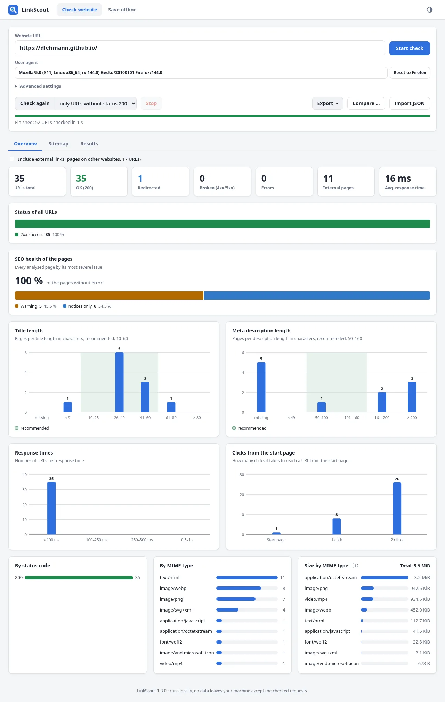
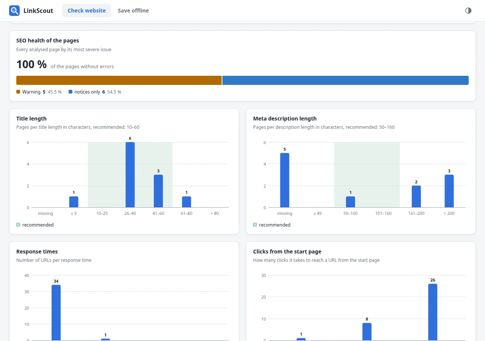
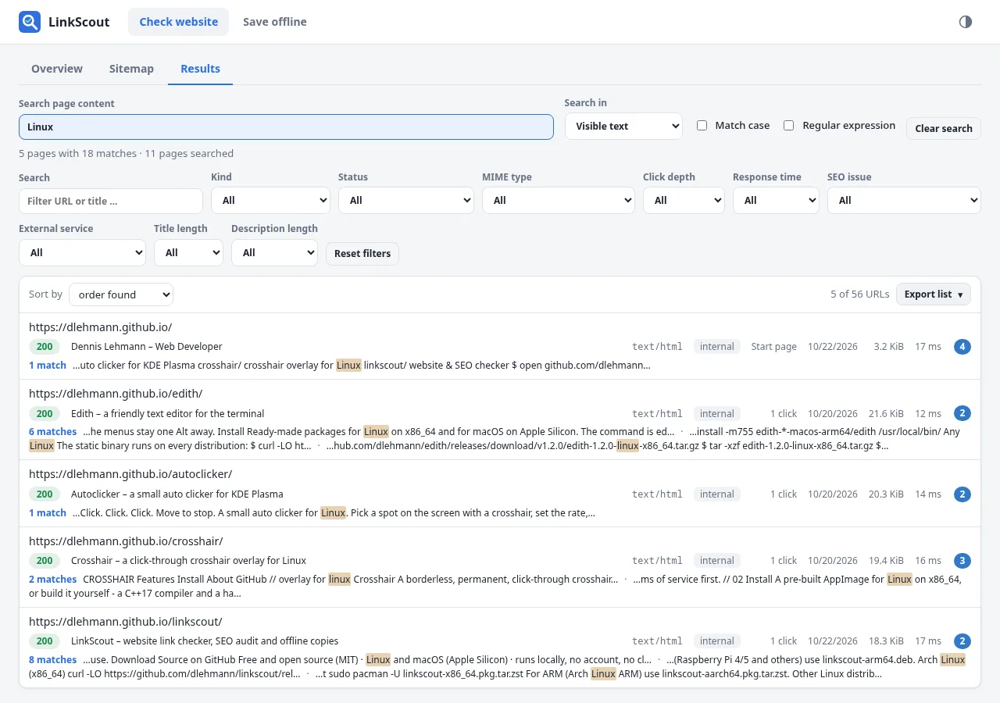
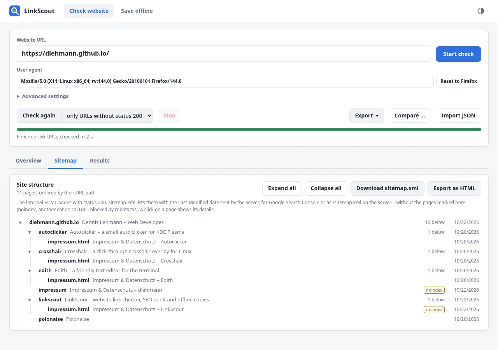
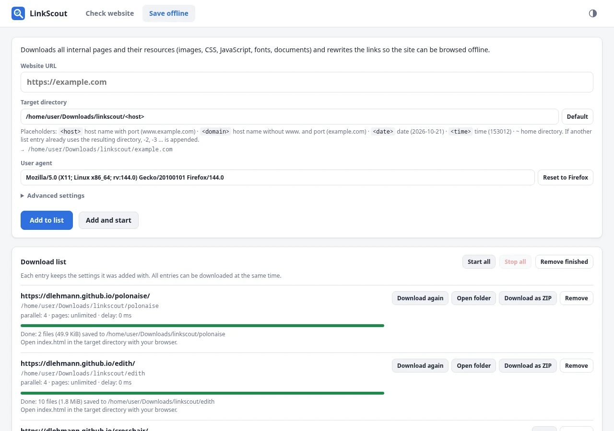

# LinkScout

**LinkScout checks every link of a website – and its SEO basics.** Enter the
address of the start page; LinkScout crawls all internal pages and checks
every URL it finds: internal pages, external links (including where redirects
end up) and linked files such as PDFs, images or downloads. 48 SEO checks
cover titles, descriptions, headings, canonicals, indexability, the sitemap,
language versions and more. The results appear in a local web interface where
you can explore, filter, compare, export and re-check them. LinkScout can also
save complete websites for offline use.

It is a single static binary for Linux and macOS. It needs no installation,
runtime or database, and nothing leaves your machine except the requests to
the checked site.

**Website:** <https://dlehmann.github.io/linkscout/> ·
**Download:** [latest release](https://github.com/dlehmann/linkscout/releases/latest)

<picture>
  <source media="(prefers-color-scheme: dark)" srcset="docs/screenshots/overview-dark.webp">
  
</picture>

## What it is for

- Find **broken links** (404, 500, DNS or TLS errors, timeouts) before your visitors do
- See which **external links redirect** and where they point now
- Get an inventory of all **PDFs, images and other files** a site links to
- Find **SEO problems**: missing or duplicate titles and descriptions,
  `noindex` pages, broken canonicals, orphan pages from the sitemap, broken
  anchors, images without alt text, hreflang mistakes and more
- **Compare** two runs: what is new, what is gone, what broke, what got fixed
- Generate a **sitemap.xml** for Google from the pages that are really there
- **Re-check** only the URLs that failed after fixing them, without crawling the whole site again
- Archive websites or take them along **offline**
- Run it in scripts or CI: a headless mode writes a JSON report and can fail the build

## Features

- **One input:** just the start URL. Everything on the same host (with or
  without `www.`, http or https) counts as internal; sub-domains are external
- **Overview:** key figures and charts – status of all URLs, SEO health of
  the pages, length of titles and meta descriptions, response times, clicks
  from the start page, status codes, MIME types and size by MIME type.
  External links can be included or left out (default: left out). Clicking a
  figure, bar or column opens the results list filtered to exactly those URLs
- **48 SEO checks**, rated as errors, warnings and notices – indexability
  (`noindex`, canonicals, robots.txt), titles, meta descriptions and headings
  (missing, duplicate, length), redirect chains and loops, links to
  redirects, broken `#anchors`, mixed content, images (alt text, size),
  sitemap (orphan pages, errors, `noindex`), click depth, hreflang, JSON-LD,
  viewport, `lang`, social media previews, duplicate content, security
  headers, certificate expiry and URL hygiene. The results list shows and
  filters them per URL; the details of a URL explain every issue with what
  exactly was found (lengths, affected images, pages with the same title …)
- **Site structure:** the *Sitemap* tab shows the internal HTML pages as a
  tree by their URL path, with title and last modification date. It exports
  a `sitemap.xml` for Google Search Console (with `lastmod` from the
  server's Last-Modified header, without `noindex` pages, pages with another
  canonical URL and pages blocked by robots.txt) and the tree as HTML list
- **sitemap.xml and robots.txt:** after the link crawl the URLs of the
  sitemap are checked too, pages only listed there appear as *not linked*.
  URLs blocked by robots.txt are marked but still checked
- **Results list** with URL, HTTP status, MIME type, title, kind (internal /
  external / file), clicks from the start page, last modification date
  (Last-Modified), size, response time and SEO issues;
  sortable, with full-text search and a filter for every column. Long URLs are
  shortened at the start, the full URL is in the tooltip. A click on a row
  shows details such as the redirect chain and the pages that link to the URL
- **Behaves like Firefox:** Firefox User-Agent and Accept headers, cookies and
  Firefox's referrer policy (`strict-origin-when-cross-origin`). The
  User-Agent can be changed in the UI; a fixed Referer can be set on the
  command line (`-referer`)
- **Password protected sites** (HTTP Basic authentication): user name and
  password under *Advanced settings*, or `-user`/`-password` on the command
  line. The credentials are only sent to the checked site, never to external
  links or CDNs, and the password never appears in exports
- **Reports and exports:** a self-contained HTML report and a PDF report
  with every figure and chart of the overview and the details of each URL
  (redirect chain, linking pages, every SEO issue with what was found);
  a JSON export and a CSV export with all data of every URL, including the
  SEO facts. JSON import; **check again** only the URLs without status 200,
  or everything; **compare** with an earlier report
- **Save offline:** downloads pages, images, CSS, JavaScript, fonts, videos
  and documents (also from CDNs), rewrites the links to relative paths and
  offers the copy as folder or ZIP. A **download list** takes several websites,
  each with its own target directory, user agent and advanced settings, and
  downloads them at the same time. The target directory supports the
  placeholders `<host>`, `<domain>`, `<date>` and `<time>` (default
  `~/Downloads/linkscout/<host>`). A site in a sub-directory, such as
  `https://user.github.io/project`, ends up directly in the target directory.
  Pages with an error status are saved anyway when they have content; the
  download list marks such entries and lists the affected URLs. Host names
  with umlauts are converted to Punycode.
- **English and German** UI, chosen from the system language (`LANG`,
  `LC_ALL`, … and the macOS language settings), English as fallback; more
  languages can be added with a single file (see [AGENTS.md](AGENTS.md)).
  Light and dark theme follow the system and can be toggled

| SEO in the overview | Results |
|---|---|
| <picture><source media="(prefers-color-scheme: dark)" srcset="docs/screenshots/seo-dark.webp"></picture> | <picture><source media="(prefers-color-scheme: dark)" srcset="docs/screenshots/results-dark.webp"></picture> |

| Site structure | Save offline |
|---|---|
| <picture><source media="(prefers-color-scheme: dark)" srcset="docs/screenshots/sitemap-dark.webp"></picture> | <picture><source media="(prefers-color-scheme: dark)" srcset="docs/screenshots/mirror-dark.webp"></picture> |

## Installation

### Debian / Ubuntu package

```bash
# x86_64 – use linkscout-arm64.deb on ARM boards
curl -LO https://github.com/dlehmann/linkscout/releases/latest/download/linkscout-amd64.deb
sudo apt install ./linkscout-amd64.deb
```

### Arch Linux package

```bash
# x86_64 – use linkscout-aarch64.pkg.tar.zst on Arch Linux ARM
curl -LO https://github.com/dlehmann/linkscout/releases/latest/download/linkscout-x86_64.pkg.tar.zst
sudo pacman -U linkscout-x86_64.pkg.tar.zst
```

Both packages install the binary to `/usr/bin`, the app-menu entry and the
icon; remove them with `sudo apt remove linkscout` or `sudo pacman -R
linkscout`.

### Download (other Linux, macOS)

Every [release](https://github.com/dlehmann/linkscout/releases) contains
ready-made, statically linked binaries for Linux x86_64, Linux arm64 and macOS
on Apple Silicon, the packages above, plus `SHA256SUMS`.

```bash
# Linux x86_64 – use linkscout-linux-arm64.tar.gz on ARM boards
curl -LO https://github.com/dlehmann/linkscout/releases/latest/download/linkscout-linux-amd64.tar.gz
tar -xzf linkscout-linux-amd64.tar.gz
sudo install -m755 linkscout-*/linkscout /usr/local/bin/
```

```bash
# macOS (Apple Silicon)
curl -LO https://github.com/dlehmann/linkscout/releases/latest/download/linkscout-darwin-arm64.tar.gz
tar -xzf linkscout-darwin-arm64.tar.gz
xattr -d com.apple.quarantine linkscout-*/linkscout   # the binary is not signed
sudo install -m755 linkscout-*/linkscout /usr/local/bin/
```

The Linux archives also contain a desktop launcher and an icon in
`packaging/` (see `make install` below for where they go).

### From source

LinkScout needs Go 1.24 or newer and has a single dependency
(`golang.org/x/net`).

Arch Linux:

```bash
sudo pacman -S --needed go git make
git clone https://github.com/dlehmann/linkscout.git
cd linkscout
sudo make install        # binary, app-menu entry and icon in /usr/local
```

Debian 13 (trixie) / Ubuntu 25.04 or newer:

```bash
sudo apt install golang-go git make
git clone https://github.com/dlehmann/linkscout.git
cd linkscout
sudo make install
```

On older releases (Debian 12, Ubuntu 24.04) `golang-go` is too old; install
the current Go from [go.dev/dl](https://go.dev/dl/) first.

Without root, install for your user only (`~/.local/bin` must be in your
`PATH`):

```bash
make install PREFIX=$HOME/.local
```

LinkScout then appears in the application menu. Starting it from there opens
the web interface; if it is already running, the existing instance is shown
instead of starting a second one. To uninstall, run `sudo make uninstall` (or
`make uninstall PREFIX=$HOME/.local`).

## Usage

```bash
linkscout https://example.com
```

This starts the web interface on <http://127.0.0.1:8088>, opens it in your
default browser and begins the check right away. Without a URL, LinkScout
starts the interface and waits for input. Stop it with `Ctrl+C`.

Headless (no UI), for scripts and CI:

```bash
# check and write a JSON report; exit code 3 if anything is broken
linkscout -report report.json -fail-on-broken https://example.com

# the same as CSV table, readable HTML or PDF report (format = file extension)
linkscout -report report.html https://example.com

# later: re-check only the URLs that were not 200 and update the report
linkscout -recheck report.json

# check again and compare with the earlier report
linkscout -report new.json -compare report.json https://example.com

# save an offline copy
linkscout -mirror ./example-offline https://example.com
```

Useful options (`linkscout -help` lists all of them):

| Option | Meaning |
|---|---|
| `-referer URL` | send this fixed Referer instead of the automatic Firefox behaviour |
| `-user-agent UA` | custom User-Agent (default: Firefox on Linux) |
| `-concurrency N` | parallel requests (default 8) |
| `-max-pages N` / `-max-depth N` | limit the crawl |
| `-delay 200ms` | pause before every request, to go easy on the server |
| `-timeout 20s` | timeout per request (for offline copies: time without new data) |
| `-user NAME` / `-password PW` | HTTP authentication for protected sites (also `https://user:pw@example.com` or env `LINKSCOUT_PASSWORD`) |
| `-no-external` | do not check external links |
| `-no-sitemap` | do not check the URLs listed in sitemap.xml |
| `-compare FILE` | compare the results with an earlier JSON report |
| `-mirror-external` | with `-mirror`: also download CDN resources |
| `-listen ADDR` | address of the web UI (default `127.0.0.1:8088`) |
| `-no-browser` | do not open the browser automatically |
| `-lang en\|de` | override the language |

## Development

```bash
make test     # unit tests
make race     # tests with the race detector
make vet      # go vet + gofmt check
make release  # static binaries for Linux (amd64, arm64) and macOS (arm64) in dist/
```

Pushes and pull requests are checked by GitHub Actions on Linux and macOS.
Pushing a version tag builds and publishes a release (the release notes are
the section of that version in [CHANGELOG.md](CHANGELOG.md)):

```bash
git tag v1.2.3 && git push origin v1.2.3
```

See [CHANGELOG.md](CHANGELOG.md) for the changes of every version and
[AGENTS.md](AGENTS.md) for the architecture, design decisions and notes for
contributors.

## License

[MIT](LICENSE) © 2026 Dennis Lehmann
